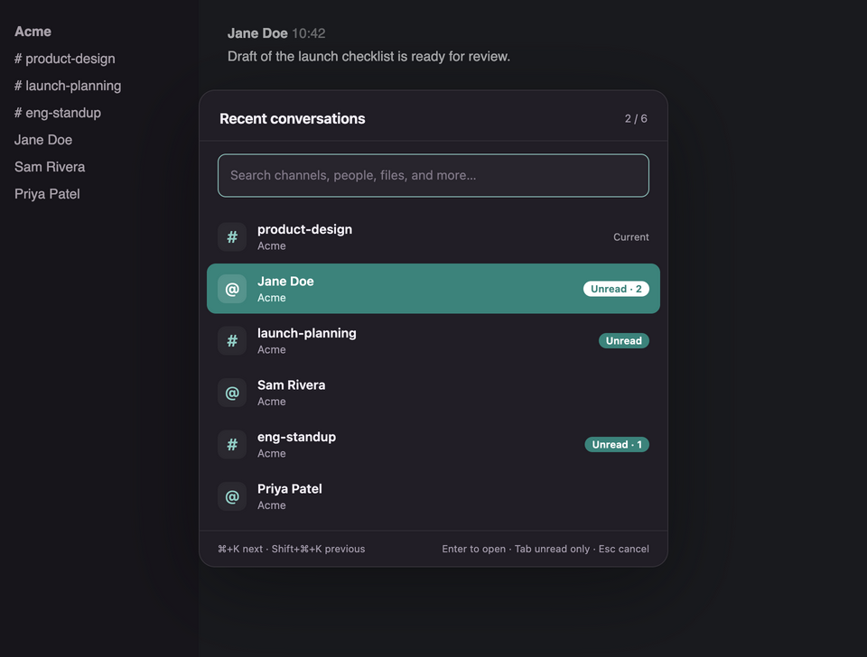
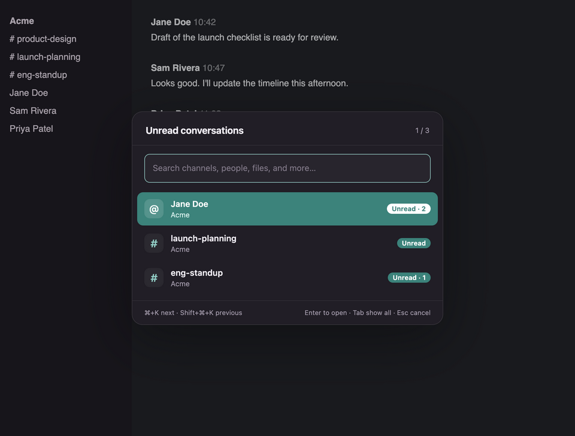
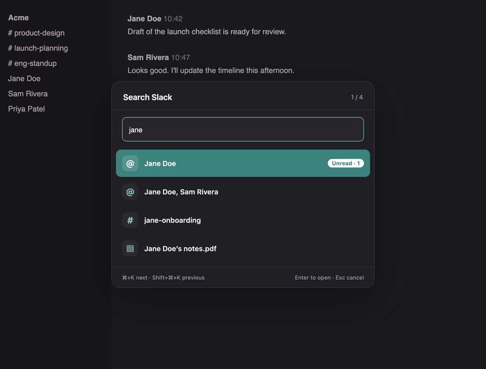
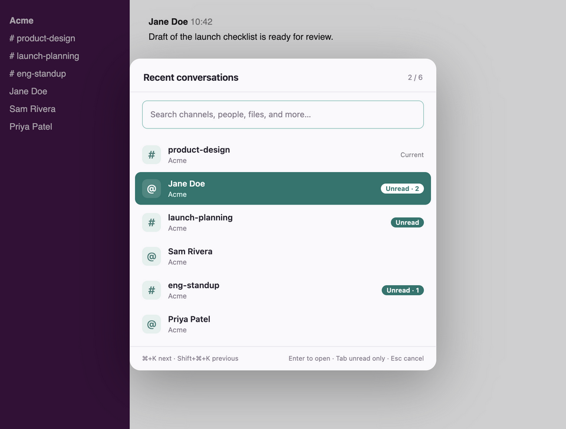

# Slack Recent Switcher

A faster way to jump between Slack conversations. Press **⌘K** (Ctrl-K on Linux and Windows) to see your recent channels and DMs, search Slack, or show only what's unread.

It's an unofficial patch applied to a copy of the Slack desktop app. Your official Slack app stays untouched.

> Not affiliated with or endorsed by Slack. Use at your own risk.

| Recent conversations | Unread only |
| --- | --- |
|  |  |

| Search | Light theme |
| --- | --- |
|  |  |

## How to use it

- **Tap ⌘K** to open the panel, then type to search Slack.
- **Hold ⌘ and press K** repeatedly to cycle through recent conversations. Let go to open one.
- **Tab** switches between all recents and unread only (current workspace).
- **Enter** opens the highlighted item. **Esc** closes the panel.

## Install

You need the official Slack desktop app and [Node.js](https://nodejs.org) 22.12 or newer.

```sh
git clone https://github.com/fazulk/slack-recent-switcher.git
cd slack-recent-switcher
npm ci
npm run install:slack
```

On macOS this creates `~/Applications/Slack Recents.app`. Open it and sign in to Slack as usual. Your recents list fills in as you visit conversations.

You can also let an agent do it: clone the repo and ask it to *"read AGENTS.md and install Slack Recents."* `AGENTS.md` also has the Linux and Windows steps and troubleshooting.

## Slack updates and reapplying the patch

**Official Slack and Slack Recents update separately.** The installer reads your official Slack installation and builds a separate patched copy. It does not change the official app's update settings. Update official Slack through its normal updater, app store, or your organization's deployment process; see [Slack's update instructions](https://slack.com/help/articles/360048367814-Update-the-Slack-desktop-app).

**Slack Recents does not auto-update.** Its patched startup code disables Electron's updater. Updating official Slack does not update the existing Slack Recents copy or remove its installed patch. Rebuild Slack Recents manually to use the newer Slack version.

| What changed? | Do I rerun the installer? |
| --- | --- |
| You quit and reopened Slack Recents | No. The patch is installed in the copied app. |
| Official Slack updated | Yes, to rebuild Slack Recents from the updated official app. Otherwise, Slack Recents stays on its previous version. |
| You pulled newer code from this repository | Yes. Pulling the code alone does not change the installed app. |

### Rebuild on macOS

1. Update **official Slack** first if a newer version is available.
2. Quit **Slack Recents** completely with **⌘Q**.
3. From your checkout of this repository, run:

```sh
git pull --ff-only
npm ci
npm run install:slack -- --source "/Applications/Slack.app" --destination "$HOME/Applications/Slack Recents.app"
```

Use your existing copy's actual destination. For example, use `--destination "/Applications/Slack Recents.app"` if that is where you installed it. Always use an unpatched official Slack app as `--source`.

4. Confirm the installer reports the expected Slack version and destination, then open the rebuilt **Slack Recents** app and check **⌘K**.

The installer replaces the app files and preserves the separate Slack Recents profile. Do not delete its profile directory as part of an update. Linux and Windows use the same rebuild sequence with their platform-specific commands and paths in [AGENTS.md](AGENTS.md#updates-and-troubleshooting).

## Good to know

- Slack Recents has its own sign-in and history, separate from the official app.
- Slack links may open in Slack Recents instead of the official app.
- The patched copy isn't signed by Slack. Your computer treats it as a locally built app.
- To uninstall on macOS, delete the Slack Recents app. Delete `~/Library/Application Support/Slack Recents` too if you want to remove its sign-in and history. For Linux and Windows, see `AGENTS.md`.
- It's used day to day on macOS. Linux has had limited testing, and Windows hasn't been run on a real desktop yet.
- Slack can change its app at any time, which may break this until it's patched again.

## Development

```sh
npm test               # unit tests
npm run test:electron  # keyboard and UI test in Slack's own Electron, offline
npm run screenshots    # regenerate the images above
```

## License

MIT. See [LICENSE](LICENSE). The license covers this project's code only.

Slack is a trademark of its owner. This project isn't affiliated with or endorsed by Slack or Salesforce, and it contains no Slack code: the installer patches the copy of Slack already on your computer. Slack's customer agreement restricts modifying its apps, so check your organization's rules before using this on a work account.

## Source Map

Sources for the installation and update instructions above:

| Claim | Source |
| --- | --- |
| Node.js requirement and install command | [package.json](package.json), `engines` and `scripts`; [AGENTS.md](AGENTS.md#install), Install. |
| Separate app copy, existing destination, original source, and manual rebuilding | [scripts/install.mjs](scripts/install.mjs), `install()`; [AGENTS.md](AGENTS.md#updates-and-troubleshooting), Updates and troubleshooting. |
| Slack Recents disables its updater and uses a separate profile | [scripts/archive.mjs](scripts/archive.mjs), `patchArchive()` generated startup code. |
| Reinstalling replaces app files while preserving the external profile | [scripts/install.mjs](scripts/install.mjs), destination replacement; [scripts/archive.mjs](scripts/archive.mjs), profile path. |
| Official Slack update methods and organization-managed versions | [Slack: Update the Slack desktop app](https://slack.com/help/articles/360048367814-Update-the-Slack-desktop-app), Check your desktop app version and Update your desktop app. |
